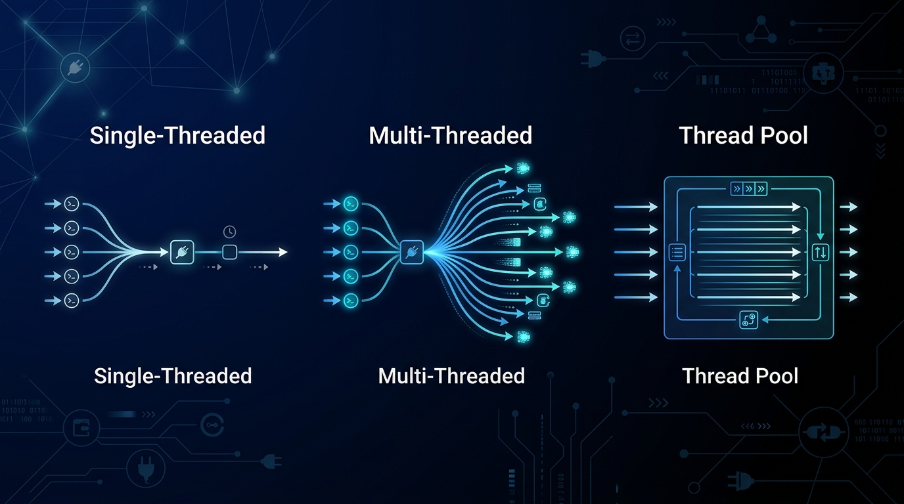

<p align="center">
  
</p>

<h1 align="center">🚀 Multithreaded Web Server</h1>

<p align="center">
  <strong>A Java-based educational project exploring server concurrency — from single-threaded to production-grade thread pools</strong>
</p>

<p align="center">
  
  
  
  
</p>

<p align="center">
  <a href="#-benchmark-results">Benchmarks</a> •
  <a href="#-architecture">Architecture</a> •
  <a href="#-quick-start">Quick Start</a> •
  <a href="#-jmeter-load-testing">JMeter</a> •
  <a href="#-interview-guide">Interview Guide</a>
</p>

---

## 📊 Benchmark Results

> **Real benchmarks** executed with Apache JMeter — Scenario A: 10 concurrent users × 10 requests (100 total)

<table>
<tr>
<th>Metric</th>
<th>⛔ SingleThreaded</th>
<th>⚡ Thread-per-Request</th>
<th>✅ ThreadPool (10)</th>
</tr>
<tr>
<td><strong>Avg Response</strong></td>
<td>🔴 988 ms</td>
<td>🟢 110 ms</td>
<td>🟢 109 ms</td>
</tr>
<tr>
<td><strong>Min Response</strong></td>
<td>184 ms</td>
<td>103 ms</td>
<td>104 ms</td>
</tr>
<tr>
<td><strong>Max Response</strong></td>
<td>1,094 ms</td>
<td>177 ms</td>
<td>178 ms</td>
</tr>
<tr>
<td><strong>Throughput</strong></td>
<td>🔴 9.0 req/s</td>
<td>🟢 49.6 req/s</td>
<td>🟢 49.1 req/s</td>
</tr>
<tr>
<td><strong>Error Rate</strong></td>
<td>0%</td>
<td>0%</td>
<td>0%</td>
</tr>
</table>

> **Key Insight:** SingleThreaded is **9x slower** and has **5x lower throughput** than concurrent servers under just 10 users. The gap widens dramatically at higher concurrency.

---

## 🏗 Architecture

### Three Evolutionary Stages

```
 ┌─────────────────────────────────────────────────────────────────────┐
 │                                                                     │
 │   Stage 1: SINGLE-THREADED         "One at a time"                 │
 │   ┌──────────────────────────────────────────┐                     │
 │   │  accept() → handle() → accept() → ...   │                     │
 │   │  ⚠️ Client 2 WAITS while Client 1 runs   │                     │
 │   └──────────────────────────────────────────┘                     │
 │                        ↓                                            │
 │   Stage 2: THREAD-PER-REQUEST       "Unlimited parallelism"        │
 │   ┌──────────────────────────────────────────┐                     │
 │   │  accept() → new Thread() → accept()     │                     │
 │   │  ✅ Parallel  ❌ Unbounded (OOM risk)     │                     │
 │   └──────────────────────────────────────────┘                     │
 │                        ↓                                            │
 │   Stage 3: THREAD POOL              "Bounded parallelism"          │
 │   ┌──────────────────────────────────────────┐                     │
 │   │  accept() → pool.execute() → accept()   │                     │
 │   │  ✅ Parallel  ✅ Bounded  ✅ Production    │                     │
 │   └──────────────────────────────────────────┘                     │
 │                                                                     │
 └─────────────────────────────────────────────────────────────────────┘
```

### Architecture Comparison

| Property | SingleThreaded | Thread-per-Request | ThreadPool |
|----------|:-:|:-:|:-:|
| Concurrency | ❌ Sequential | ✅ Parallel | ✅ Parallel |
| Memory Safety | ✅ Fixed | ❌ ~1MB/thread | ✅ Bounded |
| Backpressure | N/A | ❌ None | ✅ Work Queue |
| Graceful Shutdown | ❌ | ❌ | ✅ |
| Production Ready | ❌ | ⚠️ | ✅ |

---

## ⚡ Quick Start

### Prerequisites
- **Java** JDK 9+
- **Apache JMeter** 5.x+ *(for load testing only)*

### Compile & Run

```bash
# Clone
git clone https://github.com/AlphaDecodeX/MultithreadedWebServer.git
cd MultithreadedWebServer

# Compile any server
javac SingleThreaded/Server.java    # or Multithreaded/ or ThreadPool/

# Run (only ONE at a time — all use port 8010)
cd ThreadPool
java Server
```

```
=========================================
 THREAD POOL SERVER
 Port:     8010
 Workers:  10 threads
 Delay:    100ms per request
=========================================
[ThreadPool] Waiting for connections...
```

### Test

```bash
curl http://localhost:8010/         # → Hello from ThreadPool Web Server
curl http://localhost:8010/health   # → OK
```

---

## ⚙️ Configuration

Edit constants directly in each `Server.java`:

| Constant | Default | Description |
|----------|---------|-------------|
| `PORT` | `8010` | Server listen port |
| `REQUEST_DELAY_MS` | `100` | Simulated I/O delay (ms) — makes architecture differences visible |
| `MAX_THREADS` | `10` | *(ThreadPool only)* Worker thread count |

### Why Artificial Delay?

| Architecture | 100 requests × 100ms delay | Explanation |
|-------------|---------------------------|-------------|
| SingleThreaded | ~10,000 ms | Sequential: 100 × 100ms |
| Multithreaded | ~100 ms | All 100 threads run in parallel |
| ThreadPool (10) | ~1,000 ms | 10 batches of 10 parallel threads |

---

## 🧪 JMeter Load Testing

### Open Test Plan in GUI
```bash
jmeter -t jmeter/server-load-test.jmx
```

### Run from CLI *(recommended for benchmarks)*
```bash
# Run Scenario A (10 users × 10 requests)
jmeter -n -t jmeter/server-load-test.jmx -l jmeter/results.jtl

# Generate HTML Report
jmeter -g jmeter/results.jtl -o jmeter/report
```

### Load Scenarios

| Scenario | Users | Loops | Total | Status |
|----------|-------|-------|-------|--------|
| A | 10 | 10 | 100 | ✅ Enabled |
| B | 50 | 10 | 500 | Disabled |
| C | 100 | 10 | 1,000 | Disabled |
| D | 500 | 10 | 5,000 | Disabled |

> Enable/disable scenarios in JMeter GUI: Right-click Thread Group → Toggle

### Benchmark Procedure

```
1. Start SingleThreaded server
2. Run JMeter → Save results_single.jtl
3. Stop server (Ctrl+C)
4. Start Multithreaded server
5. Run JMeter → Save results_multi.jtl
6. Stop server (Ctrl+C)
7. Start ThreadPool server
8. Run JMeter → Save results_pool.jtl
9. Stop server (Ctrl+C)
10. Generate HTML reports
11. Compare results
```

> ⚠️ Same machine, same endpoint, same delay, same JMeter config for fair comparison.

---

## 📈 Performance Metrics

| Metric | Description |
|--------|-------------|
| **Avg Response Time** | Mean time from request to response — overall speed |
| **Min / Max Response** | Best / worst case — shows consistency |
| **Throughput (req/s)** | Server capacity under load |
| **Error %** | Failed requests — reliability indicator |
| **Std Deviation** | Response time spread — predictability |

---

## 🎯 Interview Guide

### 60-Second Project Story

> *"I built a multithreaded HTTP server in Java from scratch. Starting with a single-threaded design, I proved with JMeter benchmarks that it was 9x slower under just 10 concurrent users because requests were serialized. I evolved it to thread-per-request for parallel handling, then to a production-grade thread pool using ExecutorService — which provided bounded concurrency, backpressure via work queues, and graceful shutdown. The key insight: bounded concurrency trades small latency increases for system stability, exactly like Tomcat and Jetty do internally."*

### Key Interview Topics

<details>
<summary><strong>🔌 ServerSocket vs Socket</strong></summary>

- `ServerSocket` = **listening** socket on a port (the door)
- `Socket` = **individual connection** with a client (the conversation)
- `ServerSocket.accept()` returns a new `Socket` for each client
</details>

<details>
<summary><strong>⏸️ accept() Blocking</strong></summary>

- `accept()` makes a POSIX system call that **parks the thread in the kernel**
- Thread uses **zero CPU** while waiting
- When a client completes TCP handshake, OS wakes the thread
</details>

<details>
<summary><strong>🧵 Thread Creation Cost</strong></summary>

- Each thread: **~1MB stack** + kernel registration + scheduler overhead
- 1000 threads = ~1GB memory just for stacks
- Creation: ~1ms per thread (vs ~0ms for pool reuse)
</details>

<details>
<summary><strong>🔄 Context Switching</strong></summary>

- OS saves/restores thread state: ~1-10μs per switch
- With N threads on M cores (N >> M): constant switching = CPU waste
- Thread pool minimizes this by keeping thread count ≈ core count
</details>

<details>
<summary><strong>🏊 Thread Pool & ExecutorService</strong></summary>

- `Executors.newFixedThreadPool(N)` — N reusable worker threads
- Backed by `LinkedBlockingQueue` — excess tasks queue up
- **Backpressure**: system slows instead of crashing
- **Graceful shutdown**: `shutdown()` → `awaitTermination()` → `shutdownNow()`
</details>

<details>
<summary><strong>🔒 Resource Leaks & try-with-resources</strong></summary>

- Unclosed sockets leak OS file descriptors (limit: ~1024/process)
- `try (socket) { ... }` guarantees cleanup on ANY exit path
- Original code had socket leaks in all 3 servers — all fixed
</details>

<details>
<summary><strong>📊 Throughput vs Latency</strong></summary>

- **Throughput** = requests/second (server capacity)
- **Latency** = time per request (user experience)
- Goal: maximize throughput while keeping P99 latency within SLOs
</details>

---

## 📁 Project Structure

```
MultithreadedWebServer/
├── SingleThreaded/
│   ├── Server.java          # Sequential HTTP server
│   └── Client.java          # Manual test client
├── Multithreaded/
│   ├── Server.java          # Thread-per-request server
│   └── Client.java          # Concurrent test client
├── ThreadPool/
│   └── Server.java          # Fixed thread pool server
├── jmeter/
│   └── server-load-test.jmx # JMeter test plan (4 scenarios)
├── docs/
│   ├── banner.jpg           # README banner
│   ├── ARCHITECTURE.md      # System diagrams
│   ├── BUGS.md              # Bug tracker (11 found, all fixed)
│   ├── INTERVIEW.md         # Deep interview Q&A
│   ├── NOTES.md             # Concepts log
│   └── PROGRESS.md          # Phase tracker
└── README.md                # You are here
```

---

## 🐛 Bugs Found & Fixed

| # | Issue | Impact | Status |
|---|-------|--------|--------|
| 1 | Socket/streams never closed | File descriptor leak | ✅ Fixed |
| 2 | No HTTP response format | JMeter incompatible | ✅ Fixed |
| 3 | Client port mismatch (8090 vs 8010) | Connection refused | ✅ Fixed |
| 4 | `setSoTimeout` crashes server on idle | Server instability | ✅ Fixed |
| 5 | ThreadPool shutdown unreachable | Resource leak on exit | ✅ Fixed |

> Total: **11 bugs identified and fixed** — see [BUGS.md](docs/BUGS.md) for details

---

## 📄 License

This project is for **educational purposes** — built to understand Java concurrency, socket programming, and server architecture at the OS level.

---

<p align="center">
  <strong>Built with ☕ Java & ❤️ for understanding concurrency</strong>
</p>
