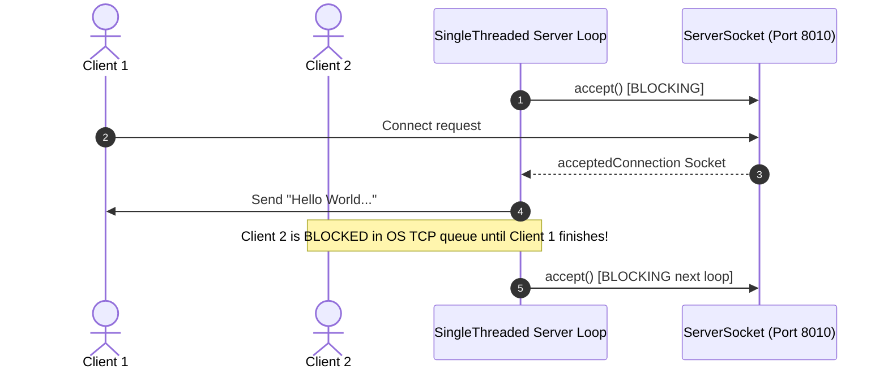

# System Architecture & Flow Diagrams

## Single-Threaded Server Flow

## Architecture Evolution Plan
1. **Single-Threaded**: Sequential handling, 1 connection at a time.
2. **Thread-per-Request**: Spawn dynamic OS thread for every incoming socket.
3. **ThreadPool**: Fixed worker threads backed by `ArrayBlockingQueue` / `LinkedBlockingQueue`.
