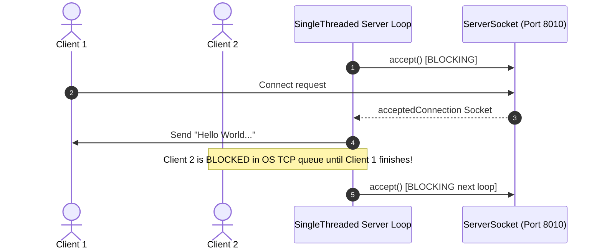

# 📖 Multithreaded Web Server — Complete Reference Guide

> This document combines all project documentation (Interview Questions, Bugs, Notes, Architecture) into a single reference file.

---

---

# 🎯 FAANG-Level System Design & Coding Interview Questions

## Question 1: What happens at the OS level when a thread calls `ServerSocket.accept()`?
- **Concept**: TCP 3-Way Handshake, SYN queue, Accept queue, OS System Call (`accept()`).
- **Answer/Trade-off**: *[To be populated after Phase 1 session]*

## Question 2: Why can't we spawn infinite Threads for each incoming HTTP request in Production?
- **Concept**: Thread stack memory overhead (1MB default per thread), Context Switching overhead, OS PID limits.
- **Answer/Trade-off**: *[To be populated after Phase 2 session]*

---

---

# 🐛 Code Smells & Bugs Table

| Bug ID | Location | Issue Description | Impact | Fix Strategy | Status |
|---|---|---|---|---|---|
| BUG-001 | `SingleThreaded/Server.java:17` | Single thread processes requests sequentially; blocked client hangs all future clients | Denial of Service under concurrent load | Introduce Multi-threading / ThreadPool | Open |
| BUG-002 | `SingleThreaded/Server.java:19-20` | Socket streams (`PrintWriter`, `BufferedReader`) and `Socket` are never closed explicitly | Resource leak (file descriptor leak) | Try-with-resources / explicit `.close()` | Open |

---

---

# 📝 Concepts Log

## Session 1: Socket Basics & Blocking I/O

### Concept 1: ServerSocket vs Socket
- *[Tu apne shabdon mein isko bhar]*
- *[Key difference between listening socket vs data transport socket]*

### Concept 2: Socket.accept() Blocking Mechanism
- *[Tu apne shabdon mein isko bhar]*
- *[OS level queue and thread block behavior]*

---

---

# 🏗️ System Architecture & Flow Diagrams

## Single-Threaded Server Flow

## Architecture Evolution Plan
1. **Single-Threaded**: Sequential handling, 1 connection at a time.
2. **Thread-per-Request**: Spawn dynamic OS thread for every incoming socket.
3. **ThreadPool**: Fixed worker threads backed by `ArrayBlockingQueue` / `LinkedBlockingQueue`.
